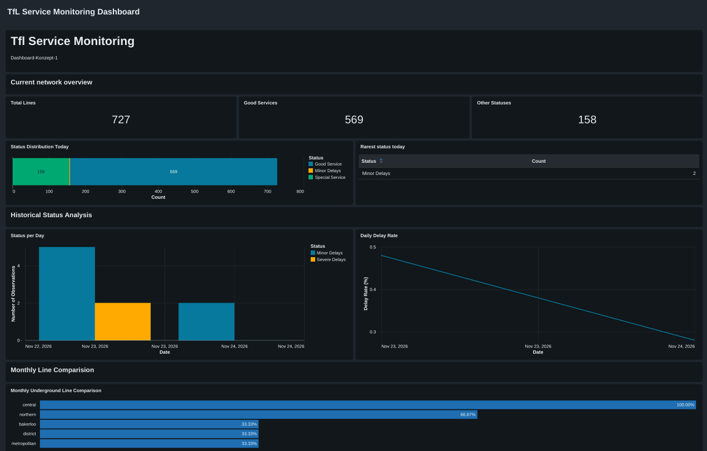

# tfl-azure-databricks-pipeline

**An end-to-end data engineering project built with Azure Databricks, PySpark, Delta Lake, and Lakeflow Declarative Pipelines to ingest, transform, and analyze public transport service data from the Transport for London (TfL) Unified API.**

## Project Overview

This project implements a data engineering pipeline that collects public transport information from the TfL Unified API, stores the raw data in Azure Storage, and processes it through a **Medallion Architecture (Bronze, Silver, Gold)**.

The pipeline processes information about transport lines, service statuses, and disruptions across different TfL transport modes.

The resulting Gold tables provide curated datasets for a Databricks AI/BI Dashboard, enabling analysis of current service conditions, historical status observations, and monthly service performance.

The project focuses on building a structured, maintainable data pipeline using Azure Databricks rather than processing static datasets through standalone notebooks.

## Technology Stack

| Technology | Purpose |
|---|---|
| Azure Databricks | Data engineering and analytics platform |
| Apache Spark / PySpark | Distributed data transformations |
| Lakeflow Declarative Pipelines | Declarative Bronze, Silver, and Gold processing |
| Delta Lake | Storage format for processed tables |
| Azure Storage | Storage of raw TfL API responses |
| Databricks Jobs | Orchestration of API ingestion |
| Unity Catalog | Data organization and governance |
| Databricks SQL / AI/BI Dashboards | SQL-based analytics and visualization |
| Git / GitHub | Version control and project documentation |

## Data Source

**Transport for London Unified API**

The pipeline retrieves data from TfL's public API, including:

- **Transport Lines:** Information about TfL lines and their associated transport modes.
- **Line Statuses:** Primary and secondary service statuses, including severity codes and descriptive information.
- **Disruptions:** Information about reported service disruptions.

The ingestion process performs approximately 720 API requests per execution, collecting the responses and uploading the raw data to Azure Storage.

Source: [TfL Unified API](https://api.tfl.gov.uk/)

## Data Architecture

```text
TfL Unified API
       |
       v
API Ingestion Job
       |
       v
Azure Storage
(Raw JSON Data)
       |
       v
+-----------------------+
| Bronze Layer          |
| Raw ingestion         |
+-----------------------+
       |
       v
+-----------------------+
| Silver Layer          |
| Streaming Tables      |
| Parsing & Validation  |
| Data Normalization    |
+-----------------------+
       |
       v
+-----------------------+
| Gold Layer            |
| Materialized Views    |
| Joins & Aggregations  |
| Analytical Metrics    |
+-----------------------+
       |
       v
Databricks AI/BI Dashboard
```

### Bronze Layer – Raw Data Ingestion

The Bronze layer ingests the raw API datasets from Azure Storage.

It preserves the source information and adds ingestion metadata to support downstream processing and the identification of related data snapshots.

### Silver Layer – Data Transformation

The Silver layer processes the raw data using **Lakeflow Streaming Tables**.

The transformations include:

- Parsing and flattening nested JSON structures.
- Extracting and normalizing relevant attributes.
- Separating primary and secondary service status information.
- Preserving multiple secondary status records associated with the same transport line.
- Preparing structured datasets for downstream joins and aggregations.
- Applying data quality expectations.

One important challenge was handling multiple secondary statuses for a single line. The initial assumption of one secondary status per line required revisiting the source data and adjusting the Silver transformation logic to prevent information loss.

### Gold Layer – Analytical Data Models

The Gold layer uses **Lakeflow Materialized Views** to create curated datasets for reporting and analysis.

Three analytical tables are implemented:

| Gold Table | Description |
|---|---|
| `line_status_snapshot` | Provides the latest observed line statuses, including primary and aggregated secondary status information. |
| `line_status_daily` | Aggregates historical status observations by line, date, and status category. |
| `line_reliability` | Calculates monthly status observation counts and percentages for comparing transport lines. |

#### Snapshot Processing

The snapshot table combines related Silver datasets using line identifiers and a shared ingestion timestamp.

Secondary status information is aggregated to preserve the intended granularity of one row per line in the latest snapshot, without losing additional status information.

#### Historical Status Analysis

The daily and monthly datasets support the analysis of recurring service conditions and observed delay patterns.

**Important:** The calculated metrics represent observations collected from the TfL API. They are not official TfL reliability statistics and do not directly measure the actual duration or number of individual service disruptions.

For example, multiple consecutive observations of `Minor Delays` may refer to the same ongoing disruption.

## Databricks AI/BI Dashboard

The project includes an interactive dashboard built using the curated Gold datasets.

The dashboard provides:

- **Current Service Overview:** Latest observed service conditions across TfL lines.
- **Status Distribution:** Breakdown of observed service statuses, including additional visibility for rare statuses.
- **Daily Delay Trend:** Percentage of observations reporting Minor or Severe Delays over time.
- **Monthly Line Comparison:** Comparison of Underground lines based on their observed delay percentages.

The SQL queries and analytical definitions were developed as part of the project. Databricks AI assistance was also used to customize dashboard visualizations and layouts.

## Dashboard Screenshots

### Initial Deployment




> This screenshot shows the dashboard shortly after its initial deployment. Historical data collection had only recently started, so time-series visualizations contain a limited number of observations.

Further screenshots will be added as additional historical data becomes available.

## Project Structure

The repository separates ingestion, table definitions, transformation logic, and setup scripts.

The Databricks pipeline source files are organized by Medallion layer, with additional files for schemas and Gold transformations.

A setup notebook provides the SQL DDL required to initialize the relevant database objects.

## Key Engineering Challenges

### Handling Nested API Data

The TfL API returns nested JSON responses that require parsing, schema handling, and normalization before they can be used for analytics.

### Multiple Secondary Statuses

Some transport lines can contain multiple secondary status records within a single snapshot.

The transformation logic was adjusted to preserve all relevant records while avoiding incorrect counts in the Gold layer.

### Consistent Snapshot Identification

Related datasets originate from separate ingestion and transformation paths.

A shared ingestion timestamp is used to associate corresponding observations and prevent historical status information from being incorrectly included in the latest snapshot.

### Designing Meaningful Metrics

Status observations are not equivalent to individual disruption events.

The Gold layer therefore distinguishes between observed service statuses and actual disruption frequency, avoiding misleading interpretations of the aggregated data.

## Deployment and Configuration

The project was developed in **Azure Databricks** with Azure Storage integration.

Deployment requires configuring the target workspace, storage access, secrets, and the relevant Unity Catalog objects before executing the ingestion and Lakeflow pipelines.

Environment-specific credentials and secrets are not included in this repository.

## Future Improvements – Version 2

Planned enhancements include:

- API ingestion logging with request timestamps, response status codes, and error information.
- Improved traceability between API requests, raw files, and processed datasets.
- CDC processing using Lakeflow capabilities where appropriate.
- Data quarantine for invalid records instead of failing the entire pipeline.
- Additional data quality checks and operational monitoring.

These improvements will extend the initial implementation toward a more robust and production-oriented data pipeline.

## Project Purpose

This project was developed as a hands-on data engineering portfolio project to apply Apache Spark, Azure Databricks, and Lakeflow concepts to a real external data source.

It demonstrates the implementation of an end-to-end data pipeline, from API ingestion and structured data transformation to analytical modeling and dashboard reporting.

The project also provides practical experience with data quality, historical snapshot processing, pipeline orchestration, version control, and cloud infrastructure.
